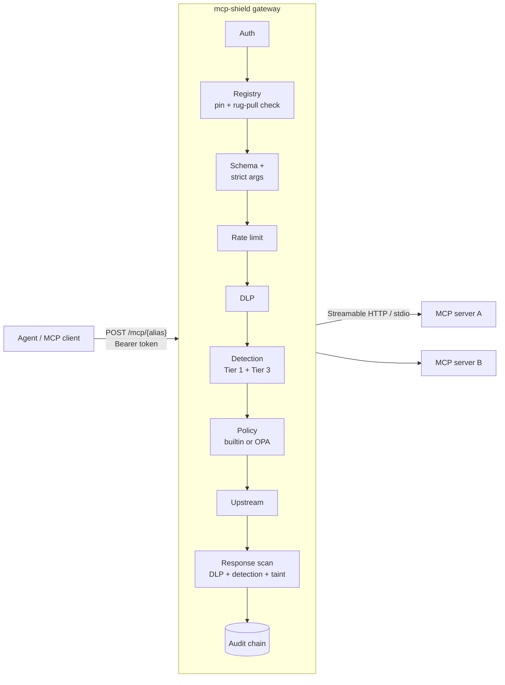

# mcp-shield

A zero-trust security gateway for the [Model Context Protocol](https://modelcontextprotocol.io). It sits between AI agents
(MCP clients) and upstream MCP servers and enforces authentication, per-agent / per-tool / per-argument authorization,
detection of prompt injection, tool poisoning and rug-pulls, session taint tracking against data exfiltration, and a
tamper-evident audit log. Agents and servers need no changes: point the client at the gateway URL.

> **Status: 0.1 alpha.** The core security pipeline is implemented and tested. Approvals workflow, admin UI,
> OpenTelemetry, Redis/Postgres backends and the Tier 2 ML classifier are **not** in this release; the evaluation
> harness exists in a first form (scripted agent, no LLM agent or third-party benchmark adapters yet). See
> [Known limitations](#known-limitations) and [docs/PROGRESS.md](docs/PROGRESS.md).

## Why

Agents are being connected to many MCP servers with no central control over tool poisoning, injection through tool
outputs, over-permissioned access or auditability. mcp-shield gives one enforcement point for all of them.

## Architecture



`tools/call` runs the stages in the order shown. A call that fails any stage is not forwarded, and every decision is
written to the hash-chained audit log. See [docs/architecture.md](docs/architecture.md).

## Quickstart (5 minutes, no external services)

Requires Python 3.12+. The package is not on PyPI yet; install from a checkout:

```powershell
pip install .                     # or: uv tool install .   (from the repository root)
mcp-shield init config            # writes gateway.yaml, agents.yaml, tool_labels.yaml
mcp-shield token new analyst      # prints a token (give it to the agent) and a config entry
```

Paste the printed `sha256` entry under `auth.tokens` in `config/gateway.yaml`, add your upstream under `servers`, then:

```powershell
mcp-shield pin scan crm -c config/gateway.yaml      # discover and pin tools (they start as pending)
mcp-shield pin list -c config/gateway.yaml
mcp-shield pin show crm export_customers -c config/gateway.yaml   # review description diff and risk
mcp-shield pin approve crm search_customers -c config/gateway.yaml
mcp-shield serve -c config/gateway.yaml             # http://127.0.0.1:8080/mcp/crm
mcp-shield audit verify -c config/gateway.yaml
```

Point any MCP client at `http://127.0.0.1:8080/mcp/<alias>` with `Authorization: Bearer <token>`:

```python
from mcp import ClientSession
from mcp.client.streamable_http import streamablehttp_client

async with streamablehttp_client("http://127.0.0.1:8080/mcp/crm", headers={"Authorization": f"Bearer {token}"}) as (
    r,
    w,
    _,
):
    async with ClientSession(r, w) as session:
        await session.initialize()
        print(await session.list_tools())
```

### Try it with the bundled mock servers (source checkout)

[config/](config) contains a ready-made demo configuration that spawns the mock MCP servers in
[mock_servers/](mock_servers) over stdio (CRM with synthetic customers, e-mail, web fetch with injected pages, files),
plus malicious variants (poisoned description, rug-pull, shadowing, injected output, hidden parameter) used by the tests.

```powershell
uv sync --all-extras ; .\.venv\Scripts\Activate.ps1
mcp-shield token new analyst                       # paste the sha256 entry into config/gateway.yaml
mcp-shield pin scan crm -c config/gateway.yaml
mcp-shield pin approve crm export_customers -c config/gateway.yaml
mcp-shield serve -c config/gateway.yaml
```

An `export_customers` call with `limit` above 50 is denied with `ARG_CONSTRAINT_VIOLATED`; the same call is never
forwarded and shows up in `mcp-shield audit tail`.

## What it stops

| Attack class | Layer that stops it | Reason code(s) |
|---|---|---|
| Tool poisoning (hidden instructions in descriptions or schemas) | Tier 1 detection on tool definitions; new tools stay `pending` until approved | `TOOL_DESCRIPTION_FLAGGED`, pin status |
| Rug pull (definition changes after approval) | SHA-256 pin of description, schema and annotations, re-verified on every call | `RUG_PULL_SUSPECTED` |
| Tool shadowing (description targets another server's tool) | Tier 1 cross-server tool-name check | `tool_shadowing` label |
| Injection in tool output (direct, indirect, hidden Unicode, base64, markup) | Response scan, Tier 1 (+ optional Tier 3 judge) | `OUTPUT_INJECTION_BLOCKED` |
| Exfiltration after reading private data and untrusted content | Session taint + egress policy, shingle provenance | `TAINT_EGRESS_BLOCKED`, `TAINT_DERIVED_EGRESS` |
| Exfiltration via URL / markdown image | Tier 1 exfil-URL rules; DLP | `OUTPUT_INJECTION_BLOCKED`, `DLP_BLOCKED` |
| Over-permissioned access / confused deputy | Per-agent server and tool allowlist | `SERVER_NOT_ALLOWED`, `TOOL_NOT_ALLOWED` |
| Argument smuggling (extra recipients, path traversal, encoded paths, wildcards, hidden parameters) | Strict schema, argument constraints, path normalisation | `ARG_CONSTRAINT_VIOLATED`, `ARGS_UNDECLARED` |
| Secrets / PII in arguments or outputs | DLP (regex + Luhn) | `DLP_BLOCKED`, `RESPONSE_DLP_BLOCKED` |
| Destructive actions | Policy always requires approval | `DESTRUCTIVE_REQUIRES_APPROVAL` |
| Rate abuse | Token buckets per (agent, tool) and (agent, server) | `RATE_LIMITED` |
| Tampering with the audit trail | Hash chain + `audit verify` | n/a |

Each row is exercised by a test (see [tests/](tests)). Attacks mcp-shield does **not** stop are listed below and in
[docs/threat-model.md](docs/threat-model.md).

## Measured results

<!-- results:start -->
| Configuration | Attack success | Block rate | False positives | Task utility |
|---|---|---|---|---|
| `no-gateway` | 95.6% | 0.0% | 0.0% | 100.0% |
| `policy-only` | 35.6% | 64.4% | 1.7% | 98.3% |
| `full` | 11.1% | 88.9% | 5.0% | 95.0% |

90 scripted attack and 60 benign scenarios, generated 2026-11-16 18:34 by `python -m evals.harness.eval`. Full tables, caveats and the failure analysis: [evals/results/results.md](evals/results/results.md).
<!-- results:end -->

These scenarios were written alongside the detector, so the rates show that documented attacks are handled and where
known evasions slip through, not how the gateway performs on real traffic. Testing and CI: [docs/testing.md](docs/testing.md).

## Configuration

One YAML file ([template](src/mcp_shield/templates/gateway.yaml)) plus `agents.yaml` (who may call what, with argument
constraints) and `tool_labels.yaml` (`reads_private`, `reads_untrusted`, `egress`, `destructive`, `read_only`).
`MCP_SHIELD_CONFIG`, `MCP_SHIELD_DATABASE_URL` and `MCP_SHIELD_MODE` override the file; see [.env.example](.env.example).
Policy details: [docs/policy-guide.md](docs/policy-guide.md). Deployment: [docs/deployment.md](docs/deployment.md).

## Design decisions

Short records live in [docs/adr/](docs/adr/). The ones that matter most:

- **Taint is scoped to the authenticated agent, not to a client-chosen session** (a compromised agent cannot reset it
  by opening a "new" session). Opt in to per-header sessions with `taint.session_scope: client_header`.
- **Fail closed everywhere**: policy and detector failures block the call, and an audit-write failure returns an
  error instead of the result; fail-open is opt-in, only for read-only tools, and every fail decision is audited.
- **Two policy backends, one policy source**: the builtin Python evaluator (no infrastructure) and OPA (REST) are held
  equal by a parity test over every policy case against the Rego files.
- **Unlabelled tools are treated as potential egress** once a session is tainted.

## Known limitations

Read this before relying on it:

- **Detection is heuristic.** Tier 1 (rules + normalisation) catches the documented patterns, including common
  obfuscation, but paraphrased or novel injections can evade it. Tier 2 (ONNX classifier) is not implemented yet; Tier 3
  (LLM judge) exists behind an interface with mock, OpenAI-compatible and Anthropic providers but is off by default and
  is itself a model that can be fooled. The measured rates above come from a self-written corpus; the failure analysis
  in [evals/results/results.md](evals/results/results.md) lists every attack that got through (non-English, ciphers,
  letter spacing, homoglyphs, paraphrase) and every benign text that was blocked.
- **Human approval is not implemented.** Calls that require approval (destructive tools, warn-band detections) are
  refused with `APPROVAL_REQUIRED` and a retry hint; there is no approve-and-continue flow yet.
- **`resources/*`, `prompts/*`, sampling and server-initiated notifications are not supported** and are refused (and
  hidden from the advertised capabilities). Only `tools/list` and `tools/call` are mediated.
- **State is in-process / SQLite.** Rate limits, taint and sessions live in gateway memory and are lost on restart;
  run a single gateway process. Postgres (`database_url`) is possible through SQLAlchemy but no driver is bundled and it
  is untested; Redis is not used.
- **Audit tail truncation is undetectable** without an externally stored head (`mcp-shield audit head`). Writers with
  database `DELETE`/`UPDATE` rights can still tamper; the chain makes that detectable, not impossible.
- **Check-then-use window:** tool definitions are verified immediately before each call, not atomically with it.
- **Taint tracking sees only what passed through the gateway.** Data the agent obtained elsewhere is invisible to it.
- **OIDC** validation is implemented and unit-tested against generated keys; it has not been run against a real
  identity provider (no Keycloak in this release).

## Development

```powershell
uv sync --all-extras
.\.venv\Scripts\Activate.ps1
python -m ruff check . ; python -m ruff format --check . ; python -m mypy
python -m pytest -q --cov          # coverage gate: 85% on src/mcp_shield
opa test policies/                  # Rego tests (needs the opa binary)
```

The OPA parity tests run automatically when an `opa` binary is on `PATH` (or at `tools/opa.exe`).

## License

See [LICENSE](LICENSE).
